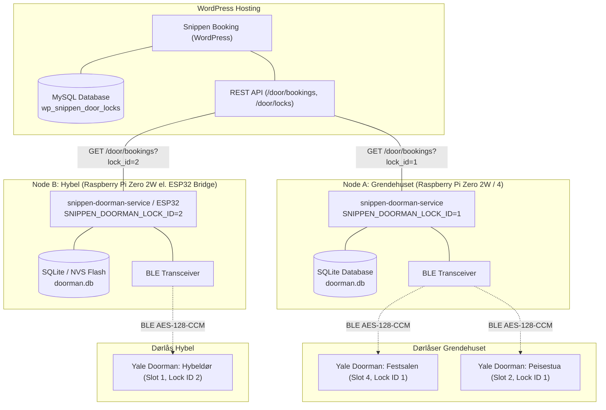

# Multi-Node Architecture & Independent Rental Units (Konsept 2)

## 1. Bakgrunn og Behov

Snippen Grendehus benytter i dag `snippen-doorman-service` for styring av dørkoder til felleslokalene (Festsalen og Peisestua). Disse dørene deler felles lås-ID (`lock_id=1`) og styres av én sentral Raspberry Pi-node plassert innenfor Bluetooth Low Energy (BLE)-rekkevidde av begge låsene (se [Issue #56](https://github.com/jonasfh/snippen-doorman-service/issues/56)).

I fremtidige utvidelser er det aktuelt å leie ut uavhengige enheter på eiendommen gjennom samme booking- og administrasjonsplattform (`snippen-booking` på WordPress), for eksempel:
1. **Hybel / Utleieleilighet** (separat inngang, uavhengig utleie)
2. **Separat møterom / anneks**
3. **Fremtidige utleieenheter eller boder**

### Kritiske arkitekturkrav:
- **Streng kodeisolasjon:** Koder utstedt til leietakere av Grendehuset må aldri programmeres på eller gi adgang til hybelen, og koder utstedt til hybelleietakere må aldri gi adgang til Grendehuset.
- **Fysisk radiorekkevidde:** Yale Doorman Access Module kommuniserer over 2.4 GHz BLE med en effektiv innendørs rekkevidde på 5–10 meter gjennom tre/gips og vesentlig kortere gjennom mur/betong. Separate boenheter eller eksterne bygg kan ikke nås pålitelig av én enkelt sentral Bluetooth-transceiver.
- **Felles administrasjonsgrensesnitt:** Administratorer og driftsansvarlige skal kunne administrere alle enheter, overvåke batterinivå og inspisere logger fra ett felles panel i WordPress.
- **Lokal offline-resiliens:** Svikt i lokalt Wi-Fi eller internettforbindelse på én enhet må ikke påvirke adgang eller drift for de øvrige enhetene.

---

## 2. Systemtopologi og Sikkerhetsgrenser

Hver fysiske utleieenhet som befinner seg utenfor rekkevidden til eksisterende noder, eller som krever uavhengig adgangskontroll, utstyres med en egen **Doorman-node**.



---

## 3. WordPress REST API-integrasjon og Ruting

WordPress-pluginen `snippen-booking` støtter allerede flerdørs ruting gjennom tabellen `wp_snippen_door_locks` og tilknytning mellom lokaler og låser:

### 3.1 Polling per Lock ID
Hver Doorman-node konfigureres med sin unike `SNIPPEN_DOORMAN_LOCK_ID`:
- **Node A (Grendehus):** Poller `GET /wp-json/snippen/v1/door/bookings?lock_id=1`
- **Node B (Hybel):** Poller `GET /wp-json/snippen/v1/door/bookings?lock_id=2`

API-et returnerer kun godkjente bookinger som hører til det spesifikke lokalet knyttet til den oppgitte låsen:
```json
[
  {
    "id": 108,
    "pin": "542918",
    "valid_from": "2026-11-01T12:00:00Z",
    "valid_to": "2026-11-05T10:00:00Z",
    "status": "confirmed"
  }
]
```

### 3.2 PIN-oppdatering (`PATCH`)
Når en node genererer eller bekrefter en PIN-kode lokalt (dersom koden ikke allerede er generert av WordPress), rapporteres koden tilbake til samme endepunkt:
`PATCH /wp-json/snippen/v1/door/bookings/108/code` med `{"pin": "542918"}`.
Dermed sendes dørkoden automatisk ut på SMS og e-post til leietakeren via `snippen-sms-service`.

---

## 4. Maskinvarealternativer for Noder

| Egenskap | Alternativ 1: Raspberry Pi Zero 2W | Alternativ 2: ESP32 BLE Gateway |
| :--- | :--- | :--- |
| **Maskinvarekostnad** | ~200–250 NOK | ~50–80 NOK |
| **Effektforbruk** | ~0.7 – 1.2 W (USB-strøm) | < 0.3 W |
| **Operativsystem** | Linux (Debian / Raspberry Pi OS) | RTOS (ESP-IDF / MicroPython) |
| **Programvare** | Kjører eksisterende `snippen-doorman-service` uendret | Spesialtilpasset lettvekts-firmware |
| **Lokal lagring** | Full SQLite med WAL-modus | NVS (Non-Volatile Storage) / LittleFS |
| **Lokal Web GUI** | Fullverdig admin dashboard på port 8080 | Minimalt konfigurasjonsgrensesnitt |
| **Oppstarts- / Boot-tid** | ~20–30 sekunder | < 1 sekund |
| **Feiltoleranse** | SD-kort kan korrumperes ved hyppige strømbrudd (mitigert med SQLite WAL) | Robust flash-minne, tåler vilkårlige strømkutt |
| **Anbefaling** | **Anbefalt standard** for enkel administrasjon og 100% kode-gjenbruk | **Alternativ** ved behov for ekstremt lavt strømforbruk eller mange noder |

---

## 5. ESP32 Lettvektsklient (Firmware-arkitektur)

For miljøer der en mikrokontroller er ønskelig fremfor en Linux-datamaskin, kan en ESP32 (f.eks. ESP32-WROOM-32 eller ESP32-C3 / ESP32-S3) fungere som en dedikert BLE-bridge.

### 5.1 Programvarestakk for ESP32
```
┌─────────────────────────────────────────────────────────┐
│               Snippen ESP32 Doorman Client              │
│       (C++ med ESP-IDF eller MicroPython / Rust)        │
├────────────────────────────┬────────────────────────────┤
│         Wi-Fi & HTTP       │            BLE             │
│   - HTTPS Client (MbedTLS) │   - NimBLE-stack           │
│   - JSON Parser (cJSON)    │   - Yale Session Crypto    │
│   - NTP Tidsynkronisering  │     (AES-128-CCM)          │
├────────────────────────────┴────────────────────────────┤
│         Persistent Cache (NVS Flash / LittleFS)         │
│          - Aktive koder, tidsluker, offline nøkler      │
└─────────────────────────────────────────────────────────┘
```

### 5.2 Nødvendig kryptografisk støtte
Yale Access Module benytter August-protokollen over BLE:
1. **Nøkkelavtale:** Offline key (16 bytes hex) og slot-nummer benyttes til å initialisere en kryptert sesjon.
2. **Kryptering:** AES-128-CCM (12-bytes nonce, 4-bytes autentiseringstag). Maskinvare-akselerert i ESP32.
3. **Sjekksum:** August 8-bit checksum kalkulert over dekryptert ramme der `command[0x03] == 0x00`.
4. **Kommandoer:**
   - `0x0027`: KeyCode_Set (programmer PIN i slot 3–9)
   - `0x002B`: KeyCode_Commit (bekreft lagring i låsens NVRAM)
   - `0x002C`: KeyCode_Clear (slett PIN fra slot ved utløp)

Referansestruktur og implementasjonsretningslinjer for ESP32 finnes i [`firmware/esp32/`](../firmware/esp32/).

---

## 6. Sentralisert Overvåking og Flåtestyring i WordPress

For å opprettholde full oversikt når antall noder og dørlåser øker, rapporterer hver node telemetri og status til WordPress.

### 6.1 Telemetridata per lås og node
Hvert 5.–15. minutt (eller ved endring) sender noden oppdatert tilstandsrapport:
```http
POST /wp-json/snippen/v1/door/status
Authorization: Bearer <SNIPPEN_DOORMAN_API_TOKEN>
Content-Type: application/json

{
  "node_id": "hybel-node-01",
  "node_version": "0.16.0",
  "lock_id": 2,
  "battery_level": 85,
  "ble_rssi": -68,
  "lock_state": "locked",
  "active_pins_count": 2,
  "free_slots_count": 5,
  "last_sync_utc": "2026-10-29T22:00:00Z"
}
```

### 6.2 Administratorvisning i WordPress
I WordPress Admin («Snippen Booking» -> «Dørlåser»):
- **Oversiktstabell:** Viser alle registrerte dører, hvilken fysisk node som betjener dem, siste vellykkede synkronisering og batteristatus.
- **Varsling ved offline noder:** Dersom en node ikke har rapportert på mer enn 3 x synkroniseringsintervall (f.eks. 15 minutter), markeres noden med gult/rødt varsel i adminpanelet, og e-post/SMS kan sendes til vaktmester/driftsansvarlig.
- **Batterivarsel:** Automatisk varsling når batterinivået på en lås faller under 20%.

---

## 7. Feilhåndtering og Offline-sikkerhet

### 7.1 Isolert feilmodus
Dersom Wi-Fi faller ut på hybelen:
- Hybelens Doorman-node går inn i autonom offline-modus.
- Alle reservasjoner som allerede er synkronisert og lagret i nodens lokale database, blir aktivert og deaktivert til fastsatte tider.
- Grendehuset og eventuelle andre noder påvirkes overhodet ikke.

### 7.2 Strømbrudd på noden
- Yale Doorman Classic drives av 4 stk. AA-batterier internt i døren og påvirkes ikke av nettstrømbrudd i bygget.
- Koder som allerede er programmert i låsens minne (slots 3–9), forblir aktive og fungerer på tastaturet selv om Doorman-noden mister strømmen.
- Når noden starter opp igjen etter strømbrudd, kjører den integritetssjekk på lokal database, kontakter WordPress for å hente eventuelle oppdateringer, og synkroniserer dørkoder uten å slette gyldige eksisterende koder.
