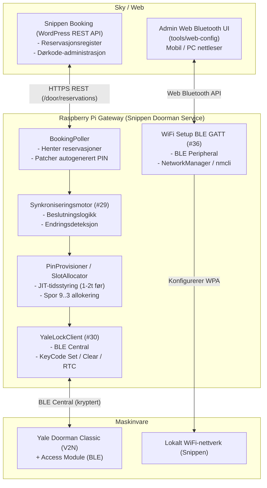
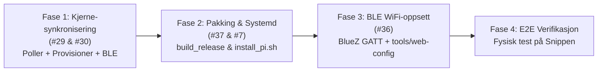

# Produksjons-roadmap og implementeringsplan

Dette dokumentet definerer veikartet og implementeringsplanen for å ferdigstille **Snippen Doorman Service** og sette den i full produksjon på en dedikert Raspberry Pi på Snippen.

---

## 1. Mål og overordnet arkitektur

Snippen Doorman Service har som hovedoppgave å automatisere adgangskontroll for Yale Doorman Classic-dørlåser basert på reservasjoner administrert i `snippen-booking`.

### Systemoversikt

---

## 2. Implementeringsfaser

Fremdriften mot produksjon er delt inn i fire tydelige faser for å sikre raskest mulig verifikasjon av kritisk funksjonalitet.

---

### Fase 1: Kjerne-synkronisering av reservasjoner mot Yale Doorman

**Tilhørende issues**: [#29](https://github.com/jonasfh/snippen-doorman-service/issues/29) og [#30](https://github.com/jonasfh/snippen-doorman-service/issues/30)

#### Mål:
Koble sammen `BookingPoller` (som henter fra Snippen Booking API) og `PinProvisioner` (som styrer låsens spor over BLE) i en helhetlig, robust kjørende bakgrunnstjeneste (`snippen-doorman service run`).

#### Nøkkeloppgaver:
1. **Felles orkestrering**:
   - `BookingPoller` poller `snippen-booking` med konfigurerbart intervall (standard 60s).
   - Nye og oppdaterte reservasjoner registreres automatisk i provisjoneringskøen (`pins`-tabellen).
   - Kansellerte/fjernede reservasjoner slettes fra provisjoneringskøen og avprogrammeres fra låsen dersom de allerede var aktive.
2. **Beslutnings- og dvaleprinsipp**:
   - Yale Doorman drives av batterier. Låsen skal **aldri vekkes unødvendig**.
   - Kun bookinger med start innenfor tidsvinduet (`valid_from - lead_time`, standard 1 time før) provisjoneres fysisk over BLE.
   - Uendrede reservasjoner skal ikke medføre BLE-tilkobling.
3. **Robusthet og feilhåndtering over BLE**:
   - Ved midlertidig BLE-frakobling eller timeout rulles ikke tilstanden tilbake; neste tikk forsøker synkronisering på nytt.
   - Tilstand i databasen markeres først som `PROVISIONED` når låsen har bekreftet operasjonen.
   - Opportunistisk lesing av batterinivå og låsetilstand under oppkobling.

---

### Fase 2: Pakking, installasjon og systemd for Raspberry Pi

**Tilhørende issues**: [#37](https://github.com/jonasfh/snippen-doorman-service/issues/37) og [#7](https://github.com/jonasfh/snippen-doorman-service/issues/7)

#### Mål:
Sikre en deterministisk, reproduserbar utrulling på Raspberry Pi OS uten manuelle steg eller risiko for konfigurasjonsfeil.

#### Nøkkeloppgaver:
1. **Distribusjonsbygging (`scripts/build_release.py`)**:
   - Pakking av kildekode til en versjonsstemplet tarball/wheel med SHA-256-sjekksum.
2. **Automatisert installasjonsskript (`scripts/install_pi.sh`)**:
   - Oppsett av `/opt/snippen-doorman-service` med dedikert virtualenv.
   - Konfigurasjon av systembruker, gruppetilhørighet (`bluetooth`, `netdev`) og D-Bus-tilganger.
   - Installasjon av systemd-service (`/etc/systemd/system/snippen-doorman.service`).
   - Oppsett av miljøvariabelmal i `/etc/snippen-doorman/snippen-doorman.env`.
3. **Hardening og adapter-recovery**:
   - Systemd-konfigurasjon for automatisk omstart ved feil.
   - Håndtering av låste Bluetooth-adaptere (`rfkill unblock bluetooth`, `hciconfig reset`).

---

### Fase 3: BLE WiFi-oppsett og administrativt webgrensesnitt

**Tilhørende issue**: [#36](https://github.com/jonasfh/snippen-doorman-service/issues/36)

#### Mål:
Gjøre det mulig for montører eller administratorer å konfigurere eller endre WiFi på Raspberry Pi uten bruk av skjerm, tastatur eller SSH, via en nettleser med Web Bluetooth API.

#### Nøkkeloppgaver:
1. **BlueZ BLE GATT Peripheral**:
   - Kjøre en lettvektig BLE peripheral-tjeneste på Pi som annonserer når WiFi mangler eller ved aktivering av oppsettmodus.
   - Eksponere egenskaper for WiFi-skanning, status og overføring av SSID/WPA-nøkkel.
2. **Linux Nettverksintegrasjon**:
   - Bruke `NetworkManager` (`nmcli`) for å liste tilgjengelige nettverk og koble til valgt SSID.
3. **Web Bluetooth Frontend (`tools/web-config/`)**:
   - Gjenbruke og tilpasse arkitekturen fra `snippen-sms-service/tools/web-config`:
     - Mobilvennlig HTML/CSS/JS PWA.
     - Kobler direkte til Raspberry Pi via Web Bluetooth i Chrome (Android, macOS, Windows).
     - Viser tilgjengelige nettverk, tar imot passord og verifiserer tilkoblingen.

---

### Fase 4: End-to-end testing og fysisk verifikasjon

#### Mål:
Validere hele livssyklusen til en reservasjon i reelle omgivelser på Snippen før systemet settes i skarp drift.

#### Verifikasjonssjekkliste:
- [ ] Leietaker bestiller i Snippen Booking -> reservasjon registreres i `snippen-booking`.
- [ ] Doorman-service poller reservasjonen, tildeler 6-sifret PIN og rapporterer PIN tilbake til `snippen-booking`.
- [ ] 1 time før reservasjonen starter: Doorman-service kobler opp mot Yale Doorman over BLE og programmerer PIN i et gjestespor (9..3).
- [ ] Leietaker taster koden på låsens fysiske tastatur og låser opp døren.
- [ ] 15 minutter etter at reservasjonen er over: Koden slettes automatisk fra låsen over BLE og sporet frigjøres.
- [ ] Tidsendring i bookingplattformen oppdaterer låsen automatisk.
- [ ] Avlyst reservasjon fjerner koden umiddelbart.
- [ ] Raspberry Pi restarter uten tap av synkroniseringsstatus og fortsetter normal drift.

---

## 3. Miljø- og konfigurasjonskrav for Raspberry Pi

| Parameter | Standardverdi | Beskrivelse |
|---|---|---|
| `SNIPPEN_DOORMAN_API_URL` | `https://vestreholmensameie.no/wp-json/snippen/v1/door` | REST API-endepunkt i WordPress |
| `SNIPPEN_DOORMAN_API_TOKEN` | *(Påkrevd)* | Bearer-token for API-autentisering |
| `SNIPPEN_DOORMAN_BLE_ADDRESS` | *(Påkrevd)* | Bluetooth MAC-adresse til Yale Access Module |
| `SNIPPEN_DOORMAN_BLE_KEY` | *(Påkrevd)* | 16-byte offline nøkkel (32 hex-tegn) |
| `SNIPPEN_DOORMAN_BLE_SLOT` | `1` | Nøkkelspor for offline-nøkkel |
| `SNIPPEN_DOORMAN_SYNC_INTERVAL` | `60.0` | Pollingintervall i sekunder mot booking API |
| `SNIPPEN_GUEST_SLOT_MIN` | `3` | Laveste gjestespor (skjermer spor 0-2 for Yale Home) |
| `SNIPPEN_GUEST_SLOT_MAX` | `9` | Høyeste gjestespor (maks 10 spor på Yale Classic) |
| `SNIPPEN_LEAD_TIME_MINUTES` | `60` | Minutter før start koden programmeres i låsen |
| `SNIPPEN_GRACE_PERIOD_MINUTES`| `15` | Minutter etter slutt koden slettes fra låsen |
